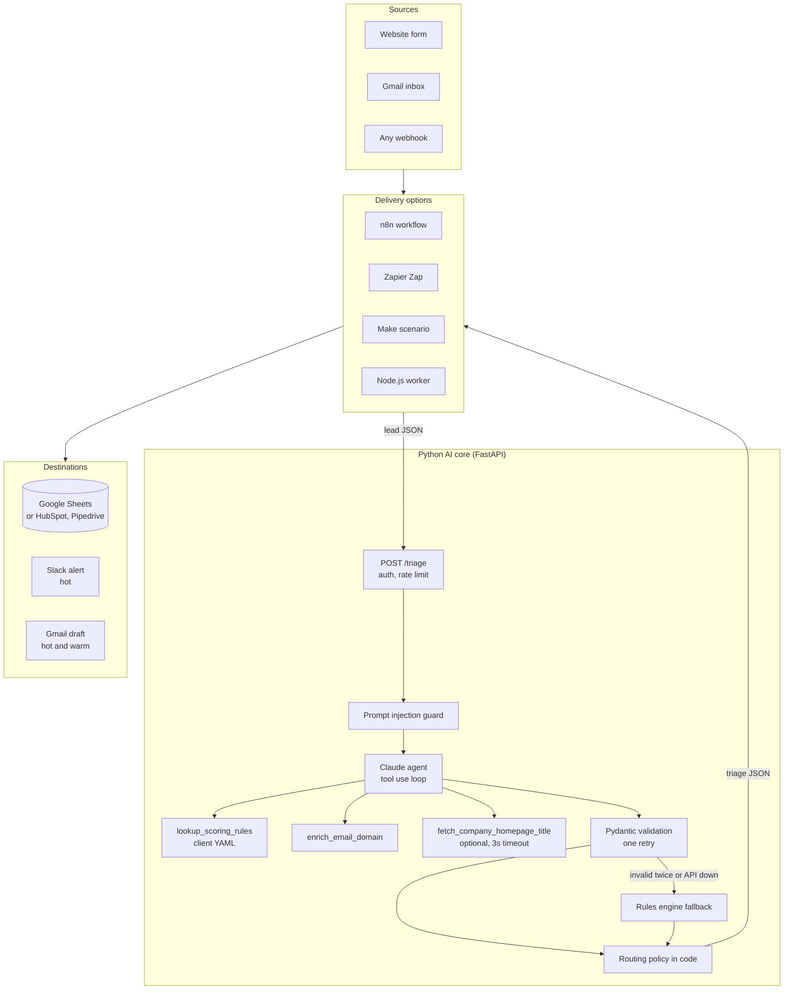

# AI Lead Triage Automation

[](https://github.com/uusammmaa/ai-lead-triage-automation/actions/workflows/ci.yml)


Every inbound lead is classified, scored and enriched by a Claude agent in seconds, then routed: hot leads ping Slack and get a drafted reply, warm leads get a draft, everything is logged to the CRM sheet, and spam never reaches a human.

**One Python AI core, four delivery options.** The intelligence lives in one tested API. Clients plug it into the tool they already use: **n8n, Zapier, Make, or a custom Node.js worker**.


---

## The problem

- **Leads go cold.** A lead contacted within the first hour is far more likely to convert than one answered the next day, yet most inboxes are worked through in arrival order, not value order.
- **Sales time is burned on noise.** SEO pitches, list sellers, job applications and support tickets land in the same form as a $25k project.
- **Nobody knows why a lead was prioritised.** Gut feel does not scale and cannot be audited.

## What it does

1. **Classifies and scores** each lead (sales, support, partnership, job seeker, spam, other) with a 0 to 100 score and plain-English reasons, using the client's own scoring rules.
2. **Enriches** it: business, free or disposable email, company guess, budget signal, urgency, a one-sentence summary and a ready-to-send reply.
3. **Routes** it: **hot** to Slack + Gmail draft + CRM, **warm** to Gmail draft + CRM, **cold** to CRM, **discard** nowhere. Replies are always drafts for a human to approve, never auto-sent.

---

## Architecture



**Why this shape.** The model does the judgement (what is this lead, how good is it, what should we say). Code owns the facts and the policy: email type comes from a deterministic lookup, routing comes from thresholds in a YAML file, and an injected lead can never be auto-routed hot. If the model returns invalid output twice, or the API is down, a rules engine answers instead, so a lead is never dropped.

---

## Pick your stack

| | **n8n** | **Zapier** | **Make** | **Custom Node.js** |
| --- | --- | --- | --- | --- |
| Platform cost per lead | Free self-hosted (server only), or n8n Cloud plan | About 3 to 4 tasks | About 3 to 4 operations | Hosting only |
| Setup | Import a file, add 4 credentials | 10 minute click-through guide | Import blueprint or 15 minute guide | `docker compose up` |
| Flexibility | High: code nodes, self-hosting, any API | Medium: huge app catalogue, simple branching | High: visual router, good data tools | Highest: it is your code |
| Data residency | Can stay on your servers | Zapier cloud | Make cloud (EU or US) | Wherever you deploy |
| Reliability features | Retries, execution log | Built-in replay | Error handlers, incomplete executions | Idempotency per lead, per-destination retry, tests |
| Choose it when | You want ownership without writing code, or volume is high | Your team already lives in Zapier and volume is modest | You need branching logic at a lower price than Zapier | Volume is high, reliability matters most, or you want zero platform lock-in |
| Files | [integrations/n8n](integrations/n8n) | [integrations/zapier](integrations/zapier) | [integrations/make](integrations/make) | [integrations/node](integrations/node) |

The AI cost (below) is the same whichever option you choose, because they all call the same core.

---

## Run it locally in 5 minutes

Needs Docker. No API key needed: without one, the core runs in **mock mode** (a deterministic rules engine), so everything works offline and costs nothing.

```bash
git clone https://github.com/uusammmaa/ai-lead-triage-automation.git
cd ai-lead-triage-automation
cp .env.example .env            # add ANTHROPIC_API_KEY here for live Claude mode
docker compose up --build
```

| Open | What |
| --- | --- |
| http://localhost:8080 | Demo form. Pick a sample lead, choose where to send it |
| http://localhost:8000/docs | Core API docs (OpenAPI) |
| http://localhost:3000/health | Node worker |
| http://localhost:5678 | n8n. Import `/files/lead-triage.workflow.json` (mounted from `integrations/n8n`) |

Or call the API directly:

```bash
curl -s -X POST http://localhost:8000/triage \
  -H 'X-API-Key: dev-key-change-me' -H 'Content-Type: application/json' \
  -d '{"name":"Dana Whitfield","email":"dana@brightpath-logistics.example.com","company":"Brightpath Logistics","message":"We have a budget of $15,000 and need lead triage within two weeks.","source":"webform"}'
```

Without Docker:

```bash
cd core && pip install -r requirements-dev.txt
uvicorn app.main:app --reload          # http://localhost:8000
pytest                                 # 87 tests
cd .. && python evals/run_evals.py     # writes evals/results.md
cd integrations/node && npm install && npm test   # 41 tests
```

---

## Results

Evaluated on [30 labelled leads](data/sample_leads.json): hot and warm sales, vague enquiries, support, partnerships, job seekers, spam and two prompt injection attempts.

| Metric | Mock mode (rules engine) |
| --- | --- |
| Category accuracy | 100% (30/30) |
| Routing accuracy | 100% (30/30) |
| Prompt injection resisted | 2/2 |
| Avg latency | under 1 ms |

**Read this honestly:** the mock rules were written alongside this dataset, so mock mode proves the pipeline, schema, routing and injection handling work end to end. It is not a benchmark of the AI. `python evals/run_evals.py --mode live` with an API key produces the model's real accuracy, latency and measured cost per lead, and rewrites [evals/results.md](evals/results.md).

## Cost per 1,000 leads

Projected from the token footprint of a typical 2-call agent run (about 2,300 input and 570 output tokens per lead, before prompt caching), at list prices:

| Model | Projected AI cost per 1,000 leads |
| --- | --- |
| `claude-sonnet-5-5` (default) | about $10 |
| `claude-haiku-5-5` (high volume, simpler leads) | about $0.50 |
| `claude-opus-5-5` (hardest judgement calls) | about $21 |

Every response reports its real token usage and cost in `meta`, and the structured logs carry the same fields, so the true figure is visible from day one. Switch models with one env var: `ANTHROPIC_MODEL`.

---

## Production touches

| Concern | How it is handled |
| --- | --- |
| Invalid AI output | Structured JSON output, Pydantic validation, one correction retry, then the rules engine |
| AI outage or refusal | Falls back to the rules engine; server-side model fallback on refusals (`ANTHROPIC_SERVER_SIDE_FALLBACK`) |
| Prompt injection | Lead wrapped as data, explicit system rules, injection tripwire, routing decided in code, injected leads capped at warm |
| Auth and abuse | `X-API-Key` (constant-time compare), per-key sliding-window rate limit, CORS allow-list from env |
| Observability | One JSON log line per request and per lead, with tokens, cost, mode and latency; message bodies are never logged |
| SSRF | Homepage fetch is off by default, domain-validated, blocks private and loopback IPs, 3 second timeout |
| Duplicates | Node worker hashes each lead; redeliveries are not re-triaged, and only failed destinations retry |
| Output safety | Sheets written as RAW (no formula injection), Slack text escaped (no `@channel`), email headers stripped of line breaks |
| House style | No em dashes in generated replies, enforced in code and checked in CI across the repo |

---

## Customising it for a client

**Scoring rules, no code.** Edit [`core/config/scoring_rules.yaml`](core/config/scoring_rules.yaml): ideal customer profile, base score per category, modifiers (budget, urgency, business email), hot and warm thresholds, category overrides, reply tone and sender name. Claude reads it through a tool; the fallback engine applies it directly. Restart the core to load changes.

**Swap the CRM.**
- n8n, Zapier, Make: replace the Google Sheets step with the HubSpot (*Create or Update Contact*) or Pipedrive (*Create Person* + *Create Deal*) step and map the same fields. The routing filters do not change.
- Node worker: add a `HubSpotCrmSink` that implements the one-method `CrmSink` interface and select it in `src/config.ts`.

**Other channels.** The same pattern adds WhatsApp (WhatsApp Cloud API or Twilio as an alert or as a lead source), Microsoft Teams, Intercom or a helpdesk for support leads. Each is one more step in the no-code options, or one more sink class in the worker.

**Other inputs.** Website forms (Webflow, WordPress, Typeform, Tally), a Gmail inbox (n8n trigger included), LinkedIn lead forms or chat widgets all work, as long as they can send `name`, `email`, `message`.

---

## Project structure

```
core/                 Python AI core (FastAPI, Claude agent, rules engine, tests, Dockerfile)
integrations/n8n/     Importable n8n workflow + setup guide
integrations/zapier/  Step-by-step Zap build + Code by Zapier snippet
integrations/make/    Make blueprint + manual build guide
integrations/node/    TypeScript worker (Express, Sheets, Slack, Gmail, vitest)
form/                 Static demo form that can post to any option
data/                 30 labelled sample leads
evals/                Eval harness and latest results
docs/                 Plain-English walkthrough, demo script, reuse copy
```

Further reading: [docs/explained.md](docs/explained.md) walks through every component in plain English, and [docs/DEMO.md](docs/DEMO.md) is a 2 minute demo script.

## License

[MIT](LICENSE)
