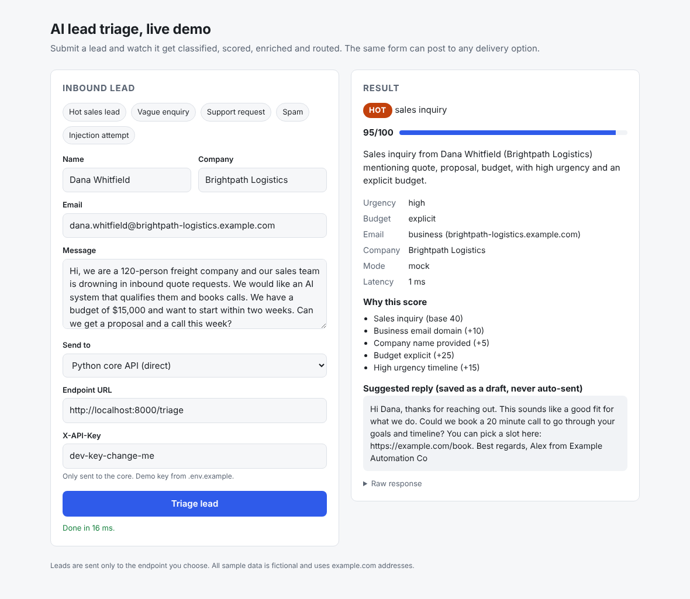
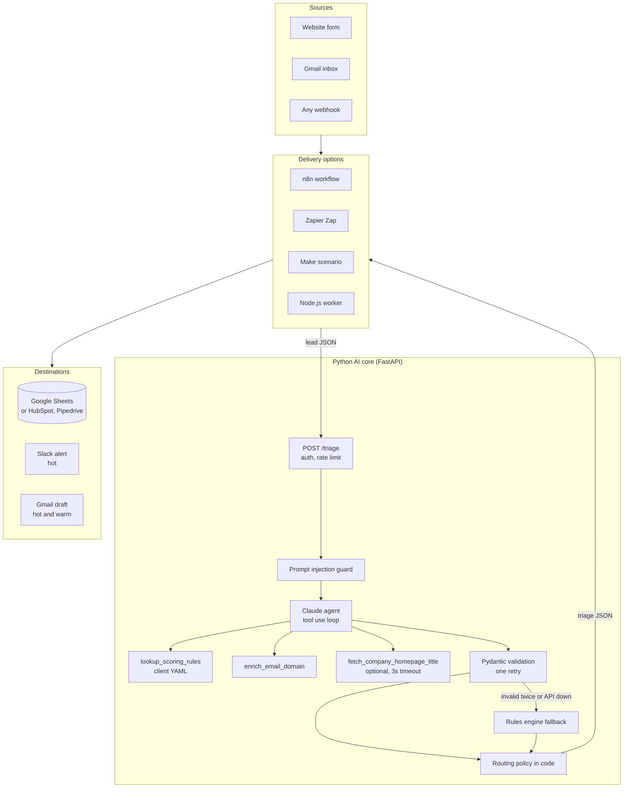

# AI Lead Triage Automation

[](https://github.com/uusammmaa/ai-lead-triage-automation/actions/workflows/ci.yml)


Every inbound lead is classified, scored and enriched by a Claude agent in seconds, then routed: hot leads ping Slack and get a drafted reply, warm leads get a draft, everything is logged to the CRM sheet, and spam never reaches a human.

**One Python AI core, four delivery options.** The intelligence lives in one tested API. Clients plug it into the tool they already use: **n8n, Zapier, Make, or a custom Node.js worker**.



---

## The problem

- **Leads go cold.** A lead contacted within the first hour is far more likely to convert than one answered the next day, yet most inboxes are worked through in arrival order, not value order.
- **Sales time is burned on noise.** SEO pitches, list sellers, job applications and support tickets land in the same form as a $25k project.
- **Nobody knows why a lead was prioritised.** Gut feel does not scale and cannot be audited.

## What it does

1. **Classifies and scores** each lead (sales, support, partnership, job seeker, spam, other) with a 0 to 100 score and plain-English reasons, using the client's own scoring rules.
2. **Enriches** it: business, free or disposable email, company guess, budget signal, urgency, a one-sentence summary and a ready-to-send reply.
3. **Routes** it: **hot** to Slack + Gmail draft + CRM, **warm** to Gmail draft + CRM, **cold** to CRM, **discard** nowhere. Replies are always drafts for a human to approve, never auto-sent.

---

## Architecture



**Why this shape.** The model does the judgement (what is this lead, how good is it, what should we say). Code owns the facts and the policy: email type comes from a deterministic lookup, routing comes from thresholds in a YAML file, and an injected lead can never be auto-routed hot. If the model returns invalid output twice, or the API is down, a rules engine answers instead, so a lead is never dropped.

---

## Pick your stack

| | **n8n** | **Zapier** | **Make** | **Custom Node.js** |
| --- | --- | --- | --- | --- |
| Platform cost per lead | Free self-hosted (server only), or n8n Cloud plan | About 3 to 4 tasks | About 3 to 4 operations | Hosting only |
| Setup | Import a file, add 4 credentials | 10 minute click-through guide | Import blueprint or 15 minute guide | `docker compose up` |
| Flexibility | High: code nodes, self-hosting, any API | Medium: huge app catalogue, simple branching | High: visual router, good data tools | Highest: it is your code |
| Data residency | Can stay on your servers | Zapier cloud | Make cloud (EU or US) | Wherever you deploy |
| Reliability features | Retries, execution log | Built-in replay | Error handlers, incomplete executions | Idempotency per lead, per-destination retry, tests |
| Choose it when | You want ownership without writing code, or volume is high | Your team already lives in Zapier and volume is modest | You need branching logic at a lower price than Zapier | Volume is high, reliability matters most, or you want zero platform lock-in |
| Files | [integrations/n8n](integrations/n8n) | [integrations/zapier](integrations/zapier) | [integrations/make](integrations/make) | [integrations/node](integrations/node) |

The AI cost (below) is the same whichever option you choose, because they all call the same core.

---

## Run it locally in 5 minutes

Needs Docker. No API key needed: without one, the core runs in **mock mode** (a deterministic rules engine), so everything works offline and costs nothing.

```bash
git clone https://github.com/uusammmaa/ai-lead-triage-automation.git
cd ai-lead-triage-automation
cp .env.example .env            # add ANTHROPIC_API_KEY here for live Claude mode
docker compose up --build
```

If your host reserves or strips `ANTHROPIC_API_KEY` (some CI runners and agent sandboxes do), set `LEAD_TRIAGE_API_KEY` instead. The core reads it only when `ANTHROPIC_API_KEY` is unset or empty.

| Open | What |
| --- | --- |
| http://localhost:8080 | Demo form. Pick a sample lead, choose where to send it |
| http://localhost:8000/docs | Core API docs (OpenAPI) |
| http://localhost:3000/health | Node worker |
| http://localhost:5678 | n8n. Import `/files/lead-triage.workflow.json` (mounted from `integrations/n8n`) |

Or call the API directly:

```bash
curl -s -X POST http://localhost:8000/triage \
  -H 'X-API-Key: dev-key-change-me' -H 'Content-Type: application/json' \
  -d '{"name":"Dana Whitfield","email":"dana@brightpath-logistics.example.com","company":"Brightpath Logistics","message":"We have a budget of $15,000 and need lead triage within two weeks.","source":"webform"}'
```

Without Docker:

```bash
cd core && pip install -r requirements-dev.txt
uvicorn app.main:app --reload          # http://localhost:8000
pytest                                 # 118 tests
cd .. && python evals/run_evals.py     # writes evals/results.md
cd integrations/node && npm install && npm test   # 41 tests
```

---

## Deploy to Vercel

The Python core also runs as a single Vercel Function (Hobby plan is enough). Docker and `docker compose` are unaffected.

1. Import the repo in Vercel and set **Root Directory** to `core`. Leave build and output settings empty.
2. Add the environment variables below (Project Settings, Environment Variables), then deploy.
3. Check `https://<your-app>.vercel.app/health`, then call `/triage` with your `X-API-Key`.

How Vercel finds the app: `pyproject.toml` sets `[tool.vercel] entrypoint = "app.main:app"` and lists the runtime dependencies (Vercel installs from `pyproject.toml`, Docker from `requirements.txt`; a test keeps them in sync). `.python-version` pins Python 3.12. `vercel.json` sets the framework to FastAPI, gives the function a `maxDuration` of 120 seconds (one Haiku run plus one possible Sonnet escalation, well under the Hobby cap of 300) and leaves `tests/` out of the bundle. `config/scoring_rules.yaml` ships with the function; the few-shot examples live in code.

| Variable | Notes |
| --- | --- |
| `LEAD_TRIAGE_API_KEY` | **Secret** (mark it Sensitive). Your Anthropic key. Without a key the core runs in mock mode |
| `API_KEYS` | **Secret** (mark it Sensitive). Comma-separated keys accepted in `X-API-Key`. Always set it on a public URL: empty disables auth |
| `ANTHROPIC_MODEL` | Default `claude-haiku-5-5` |
| `ESCALATION_MODEL`, `ESCALATION_CONFIDENCE_THRESHOLD` | Default `claude-sonnet-5-5` and `0.6`. Empty model disables escalation |
| `MOCK_MODE` | `auto` (mock only when no key) |
| `ANTHROPIC_EFFORT`, `ANTHROPIC_SERVER_SIDE_FALLBACK` | Default `low` and `true` |
| `PROMPT_CACHING`, `FEW_SHOT_EXAMPLES`, `RULES_PREFILTER` | Default `true` |
| `MAX_OUTPUT_TOKENS`, `TEMPERATURE` | Default `1500` and empty |
| `RATE_LIMIT_PER_MINUTE` | Default `60`, per key **per instance** (see below) |
| `CORS_ORIGINS` | The browser origins that call the API, for example your form's URL |
| `ENABLE_HOMEPAGE_FETCH`, `LOG_LEVEL` | Default `false` and `INFO` |
| `SCORING_RULES_PATH` | Leave unset to use the bundled `config/scoring_rules.yaml` |

Serverless notes:
- **Rate limit is per instance.** The limiter lives in memory, and Vercel may run several instances at once, each with its own counters, so the real ceiling is `RATE_LIMIT_PER_MINUTE` times the number of warm instances. It fails closed: a limit of 0 denies everything, and once 10,000 keys are tracked a new key gets 429 until idle ones expire. For a hard global limit, move it to a shared store such as Redis, or add a Vercel Firewall rate-limit rule.
- **No disk writes.** Logs go to stdout (visible in Vercel logs) and nothing is written to disk, so the read-only function filesystem is fine.
- **Counters reset.** The `stats` block on `/health` is per instance and resets on cold starts.

---

## Results

Evaluated on two labelled sets: [30 sample leads](data/sample_leads.json) written alongside the rules engine, and [40 hard holdout leads](data/holdout_leads.json) written later to break things (German, Urdu and Arabic, one-liners, long rambling messages, recruiters, partnerships disguised as sales, and three new injection styles: hidden in a signature, a fake system message, and JSON in the message body).

<!-- results:start -->
| Config | Dataset | Category acc. | Routing acc. | Injection resisted | Escalation rate | Skipped by pre-filter | p50 / p95 latency | Cost per 1,000 leads |
| --- | --- | --- | --- | --- | --- | --- | --- | --- |
| Mock (rules engine) | sample | 100% (30/30) | 100% (30/30) | 2/2 | n/a | 5 of 30 | 1 / 2 ms | $0.00 |
| Mock (rules engine) | holdout | 45% (18/40) | 58% (23/40) | 3/3 | n/a | 0 of 40 | 1 / 3 ms | $0.00 |
| Haiku only | sample | 100% (30/30) | 100% (30/30) | 2/2 | 0% (0/25) | 5 of 30 | 5029 / 6153 ms | $0.51 |
| Haiku only | holdout | 98% (39/40) | 98% (39/40) | 3/3 | 0% (0/40) | 0 of 40 | 5364 / 7251 ms | $0.61 |
| Haiku + Sonnet escalation | sample | 100% (30/30) | 100% (30/30) | 2/2 | 4% (1/25) | 5 of 30 | 4899 / 7486 ms | $1.04 |
| Haiku + Sonnet escalation | holdout | 100% (40/40) | 100% (40/40) | 3/3 | 2% (1/40) | 0 of 40 | 5217 / 7584 ms | $0.78 |
| Sonnet only `v1` | holdout | 98% (39/40) | 98% (39/40) | 3/3 | 0% (0/40) | 0 of 40 | 5008 / 7071 ms | $8.10 |
<!-- results:end -->

**Read this honestly.** The keyword rules score 100% on the set they were written with and 45% on leads they have never seen. On that holdout, every model config scores 98% to 100% on category (routing 98% to 100%, against 58% for the rules): an uplift of **53 to 55 points** over the rules engine, and the reason the AI exists. Live numbers are from real API runs on 2026-10-19, after one prompt revision (`v2`, see [evals/results.md](evals/results.md) for before and after, the confusion matrix and the spend ledger). Sonnet was run once, on the `v1` prompt, and is the reference, not the default.

Two caveats. At 98% to 100% the models are at the ceiling of a 70-lead set: one lead is 1.4 to 3.3 points, so the differences between model configs are noise. And in every run, escalation never changed a label: the leads Haiku sent to Sonnet were already right. It stays on as a cheap safety net, because Haiku's one wrong answer in `v2` came with a confidence (0.55) below the escalation threshold. Re-run with `python evals/run_evals.py --matrix`, which spends real money under a hard cap; see [evals/README.md](evals/README.md).

## Cost per 1,000 leads

The default is the cheapest model, `claude-haiku-5-5`, with a second opinion from `claude-sonnet-5-5` only when Haiku reports low confidence or fails validation twice. Cost levers, each switchable in `.env`:

| Lever | What it saves | Setting |
| --- | --- | --- |
| Rules pre-filter | Disposable emails and blatant spam never reach the model | `RULES_PREFILTER` |
| Prompt caching | Tools, instructions and examples (about 2,500 tokens) are billed at 0.1x after the first lead | `PROMPT_CACHING` |
| Few-shot examples | Eight compact hard cases, inside the cached prefix | `FEW_SHOT_EXAMPLES` |
| Low effort, tight output | Less thinking, capped output, JSON only | `ANTHROPIC_EFFORT`, `MAX_OUTPUT_TOKENS` |
| Confidence escalation | Pay Sonnet prices only for the leads that need them | `ESCALATION_MODEL`, `ESCALATION_CONFIDENCE_THRESHOLD` |

Measured on the live evals (prompt caching on, pre-filter on): **$0.51 to $0.61 per 1,000 leads on Haiku**, $0.78 to $1.04 with Sonnet escalation, and $8.10 on Sonnet alone. All live evals together (320 lead triages: the matrix plus the `v2` re-runs) cost $0.53. Every response reports its measured token usage, cache reads and cost in `meta`; `/health` reports the running escalation rate and how many model runs the pre-filter saved.

---

## Production touches

| Concern | How it is handled |
| --- | --- |
| Invalid AI output | Structured JSON output, Pydantic validation, one correction retry, then escalation to Sonnet, then the rules engine |
| AI outage or refusal | Falls back to the rules engine; server-side model fallback on refusals for models that support it (`ANTHROPIC_SERVER_SIDE_FALLBACK`) |
| Uncertain answers | The model returns a 0 to 1 confidence; below the threshold the lead is re-run once on the escalation model |
| Prompt injection | Lead wrapped as data, explicit system rules, injection tripwire, routing decided in code, injected leads capped at warm |
| Auth and abuse | `X-API-Key` (constant-time compare), per-key sliding-window rate limit (in memory, so per instance on serverless), CORS allow-list from env |
| Observability | One JSON log line per request and per lead, with tokens, cost, mode and latency; message bodies are never logged |
| SSRF | Homepage fetch is off by default, domain-validated, blocks private and loopback IPs, 3 second timeout |
| Duplicates | Node worker hashes each lead; redeliveries are not re-triaged, and only failed destinations retry |
| Output safety | Sheets written as RAW (no formula injection), Slack text escaped (no `@channel`), email headers stripped of line breaks |
| House style | No em dashes in generated replies, enforced in code and checked in CI across the repo |

---

## Customising it for a client

**Scoring rules, no code.** Edit [`core/config/scoring_rules.yaml`](core/config/scoring_rules.yaml): ideal customer profile, base score per category, modifiers (budget, urgency, business email), hot and warm thresholds, category overrides, reply tone and sender name. Claude reads it through a tool; the fallback engine applies it directly. Restart the core to load changes.

**Swap the CRM.**
- n8n, Zapier, Make: replace the Google Sheets step with the HubSpot (*Create or Update Contact*) or Pipedrive (*Create Person* + *Create Deal*) step and map the same fields. The routing filters do not change.
- Node worker: add a `HubSpotCrmSink` that implements the one-method `CrmSink` interface and select it in `src/config.ts`.

**Other channels.** The same pattern adds WhatsApp (WhatsApp Cloud API or Twilio as an alert or as a lead source), Microsoft Teams, Intercom or a helpdesk for support leads. Each is one more step in the no-code options, or one more sink class in the worker.

**Other inputs.** Website forms (Webflow, WordPress, Typeform, Tally), a Gmail inbox (n8n trigger included), LinkedIn lead forms or chat widgets all work, as long as they can send `name`, `email`, `message`.

---

## Project structure

```
core/                 Python AI core (FastAPI, Claude agent, rules engine, tests, Dockerfile, vercel.json)
integrations/n8n/     Importable n8n workflow + setup guide
integrations/zapier/  Step-by-step Zap build + Code by Zapier snippet
integrations/make/    Make blueprint + manual build guide
integrations/node/    TypeScript worker (Express, Sheets, Slack, Gmail, vitest)
form/                 Static demo form that can post to any option
data/                 30 labelled sample leads
evals/                Eval harness and latest results
docs/                 Plain-English walkthrough, demo script, reuse copy
```

Further reading: [docs/explained.md](docs/explained.md) walks through every component in plain English, and [docs/DEMO.md](docs/DEMO.md) is a 2 minute demo script.

## License

[MIT](LICENSE)
